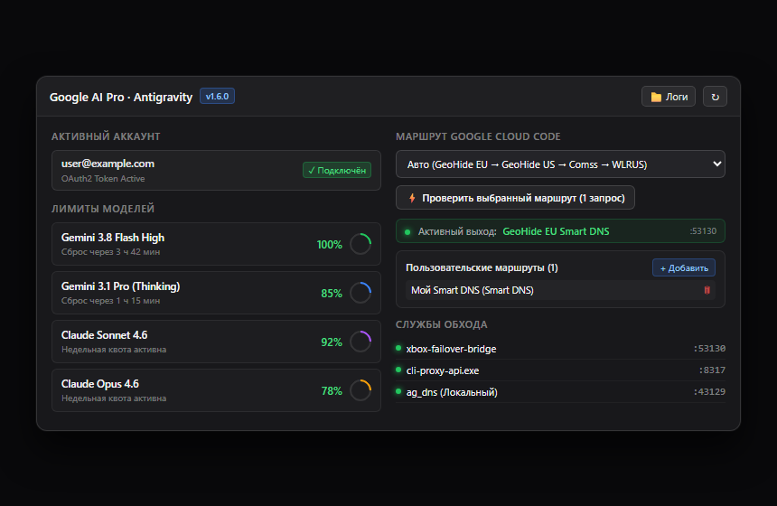
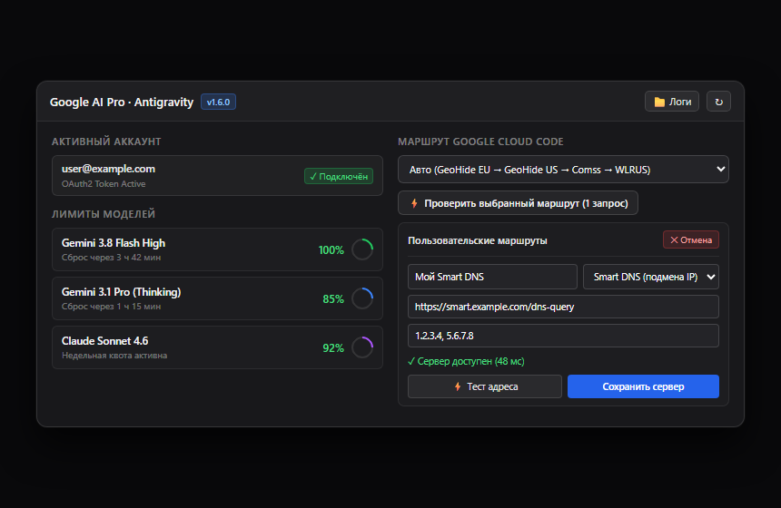

# dsh-plugin-antigravity-quota

Плагин для DeepSeek Harness (DSH), обеспечивающий подключение к Google AI Pro (Gemini, Claude) через локальный мост, DNS/SNI туннели и поддержку Smart DNS.



## Возможности

- **Мониторинг квот и переключение аккаунтов**:
  - Отображение остатка 5-часовых и недельных лимитов моделей.
  - Таймеры до обновления квот.
  - Переключение между несколькими Google-аккаунтами в один клик.
- **Маршрутизация Cloud Code**:
  - **Режим Auto**: приоритетный перебор между серверами GeoHide EU и US Smart DNS.
  - **Karing SOCKS5**: прямое подключение к локальному клиенту Karing (`127.0.0.1:3066`).
  - **Пользовательские маршруты (Custom Routes)**: добавление собственных DoH, Smart DNS и SOCKS5-прокси с быстрой проверкой связи.
- **Диагностика**:
  - Тест реальной генерации в 1 клик для проверки доступности выбранного маршрута.
  - Запись сбоев в `last-incident.json` для локализации сетевых ошибок.
  - Быстрый доступ к папке логов через кнопку в интерфейсе.



## Архитектура

```
DeepSeek Harness
       │
       ▼ (OpenAI API)
cli-proxy-api.exe :8317 ── (OAuth2 авторизация и трансляция формата)
       │
       ▼ (HTTP CONNECT)
xbox-failover-bridge :53130 ── (Диспетчер маршрутов)
       │
       ├─► GeoHide EU Smart DNS (:443)  [Основной выход]
       ├─► GeoHide US Smart DNS (:443)  [Резервный Smart DNS]
       ├─► Пользовательские серверы     [SOCKS5 / DoH / Smart DNS]
       └─► Karing Proxy (:3066)         [SOCKS5 туннель]
```

- **`cli-proxy-api.exe` (`:8317`)** — локальный сервис, переводящий OpenAI-совместимые запросы Harness в формат Google Cloud Code с авторизацией аккаунта.
- **`xbox-failover-bridge` (`:53130`)** — локальный CONNECT-мост, разделяющий потоки (авторизация идёт напрямую, генерация — через туннели).
- **Совместимый слушатель (`:53129`)** — проксирует трафик на порт 53130 для обратной совместимости.

## Установка и обновление

### Быстрая установка в 1 клик (Рекомендуется)

1. Скачайте архив релиза (`.zip`) со страницы [Releases](../../releases) и распакуйте в любое удобное место.
2. Закройте **DeepSeek Harness**.
3. Запустите двойным кликом **`install.bat`** (или выполните команду `powershell -ExecutionPolicy Bypass -File bin\install-active-profile.ps1`).
4. Скрипт сам снимет блокировку SmartScreen (Mark-of-the-Web), скопирует файлы в профиль DSH и зарегистрирует плагин в `package.json`.
5. Запустите DeepSeek Harness — виджет появится в правом нижнем углу интерфейса.

### Ручная установка

1. Распакуйте архив релиза в каталог:
   ```text
   C:\Users\<Имя_Пользователя>\.dsh\profiles\desktop\node_modules\dsh-plugin-antigravity-quota
   ```
2. Убедитесь, что в файле `~/.dsh/profiles/desktop/package.json` плагин указан в `dependencies` и `dsh.profile.bundles`:
   ```json
   {
     "dependencies": {
       "dsh-plugin-antigravity-quota": "^1.6.0"
     },
     "dsh": {
       "profile": {
         "bundles": [
           "dsh-plugin-antigravity-quota"
         ]
       }
     }
   }
   ```
3. Запустите DeepSeek Harness.

## Проверка статуса

Для проверки состояния локальных портов и моста запустите:
```powershell
powershell.exe -NoProfile -ExecutionPolicy Bypass -File "bin\diagnose-routing.ps1"
```

## Безопасность

- Запросы генерации передаются по сквозному TLS-шифрованию без расшифровки на локальном мосту.
- Запросы авторизации (`oauth2.googleapis.com`) передаются напрямую без промежуточных релеев.
- Учётные данные и токены сессий хранятся локально в системном каталоге пользователя `~/.cli-proxy-api`.

## Сторонние компоненты и благодарности

Плагин построен с использованием наработок открытых проектов сообщества:

- [router-proxy/cli-proxy-api](https://github.com/router-proxy/cli-proxy-api) — локальный сервис трансляции вызовов OpenAI API в протокол Google Cloud Code.
  - SHA-256 (`cli-proxy-api.exe`): `46b2c842fe00743d5d9ded023d47cbc5fc8c43f6a0c9135d969b35a9f4b7f1d1`
- [confeden/Antigravity](https://github.com/confeden/Antigravity) — компонент `ag_dns.exe` для локальной DNS/SNI маршрутизации.
  - SHA-256 (`ag_dns.exe`): `88afcf43c1fdd2acc9ea23820fdc70e24cca32e205185b6b620967f6447f2b3d`
- [GeoHide](https://geohide.ru/) — публичные резолверы Smart DNS для обхода региональных ограничений.

Все сторонние бинарные компоненты используются в оригинальном неизменном виде в соответствии с условиями их лицензий.

## Лицензия

MIT
